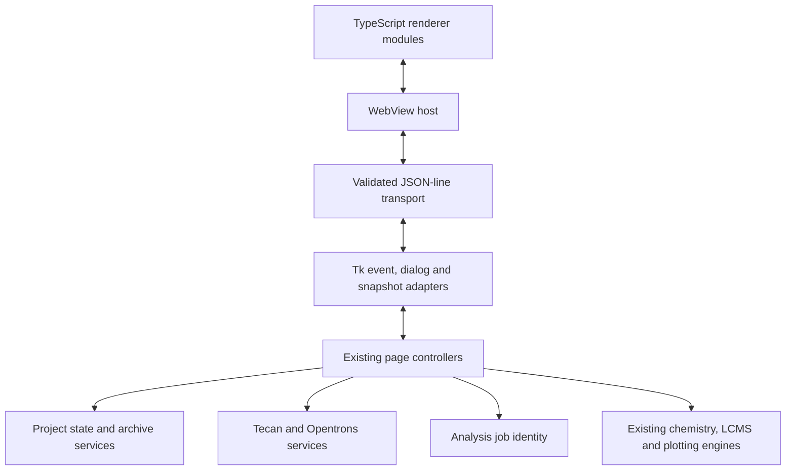

# XinPilot desktop: current engineering overview

The visible application uses the TypeScript desktop interface. This document
maps the maintained source, compatibility adapters and service boundaries.

## Dependencies and responsibilities



The services under `xinpilot/application` accept ordinary records, dataclasses
and paths. They do not import Tk, WebView, page controllers, RDKit or the broad
legacy `xinpilot_shared` module. Tests enforce this direction of dependency.
Existing chemistry engines remain in their established locations and retain
their numerical behavior. No PyParse engine was edited.

The hidden Tk layer is retained as an explicit compatibility adapter. It still
owns established layout, callbacks and some interactive workflow state. This
edition is not a complete Tk-free rewrite or a newly implemented public API.
Keeping that boundary preserves small behaviors such as repeated dropdown
selection, map dragging, nested prompts, table selection and plot interaction.

## Code map

| Concern | Maintained implementation | Adapter / entry point |
| --- | --- | --- |
| Project schema, detached snapshots and step history | `xinpilot/application/project_state.py` | `integrated_full_software.py` |
| Portable archive import/export and atomic saves | `xinpilot/application/project_archive.py` | Existing project methods on the integrated controller |
| Earlier-step assets | `xinpilot/application/project_history.py` | `archived_project_assets.py` remains a compatibility import |
| Tecan geometry and transfer records | `xinpilot/application/tecan_domain.py` | `tecan_frame.py` retains existing public model imports |
| GWL commands, chemical maps and volumes | `xinpilot/application/tecan_worklist.py` | Tecan controller supplies blocks, aliases and inventory conflicts |
| Opentrons configuration and row records | `xinpilot/application/opentrons_domain.py` | `opentrons_frame.py` |
| Opentrons physical-operation validation | `xinpilot/application/opentrons_validation.py` | Compiler and controller adapters |
| Complete Opentrons protocol compilation | `xinpilot/application/opentrons_protocol.py` | `OpentronsCompileRequest` into `compile_protocol` |
| Analysis input/target identity helpers | `xinpilot/application/analysis_jobs.py` | `pyparse_runner_frame.py` keeps original import names |
| Shared legacy boolean interpretation | `xinpilot/application/values.py` | Re-exported by `xinpilot_shared.py` |
| Wire messages and allowlisted operations | `desktop/protocol.py` | Existing event/snapshot wire format |
| Thread-safe replies, timeouts and EOF | `desktop/transport.py` | `LiveBridge` in `desktop/live_app.py` |
| Controller-thread request scheduling | `desktop/controller_server.py` | `desktop/live_engine.py` |
| Tk projection, events and prompts | `desktop/tk_snapshot.py`, `tk_events.py`, `tk_dialogs.py` | `Controller` keeps its existing entry points |
| Renderer entry and session state | `desktop/live_ui/app.ts`, `src/state.ts`, `src/startup.ts` | Bundled `dist/app.js` |
| Controls, tables and traces | `src/widgets.ts`, `tree.ts`, `canvas.ts`, `combobox.ts` | Shared wire types in `src/types.ts` |
| Dialogs, window reconciliation and bridge events | `src/dialogs.ts`, `render.ts`, `bridge.ts`, `dom.ts` | `src/diagnostics.ts` preserves existing diagnostic globals |

## Data ownership

- A project export captures detached records. Packaging works on that private
  snapshot; a failed save does not overwrite the previous project file.
- Imported project state is validated before it is applied. Existing project
  extensions, field names and version-one JSON records remain supported.
- Robot services do not read live widget variables. The controllers collect
  a request, invoke the service, then display or save the returned protocol.
- Renderer state contains view nodes, assets and transient UI flags. It does
  not become a second chemical/project database.
- Every bridge request has a correlation ID. Out-of-order replies go to the
  correct caller; EOF wakes waiters and stops the orphaned hidden controller.
- Dialog hooks are installed for the controller lifetime and restored when it
  stops. Project data do not live in the projection/font/image caches.

## Compatibility evidence

The robot contract fixtures contain nine inputs and SHA-256 hashes captured from
the original Local compiler. They cover Flex and OT-2, air gaps, excess-to-waste,
mixing/delays, eight-channel operation, per-channel batch chemicals, a temperature
module and retained-tip sequences. Tests compare complete generated protocol
text, including command order. Tecan command/map contracts and existing workflow
tests remain in place.

Project tests cover import/export/re-export, preserved prior-step assets, legacy
formats, invalid inputs, detached state and simulated save failure. Desktop
checks exercise the actual WebView2 interface, not only service functions.
These checks do not prove every possible experimental configuration or replace
physical instrument validation.

The display audit distinguishes intentional ellipsis with an exact full-text
tooltip from unintended text clipping. The same long status-label behavior was
verified against Local's original renderer before updating that test.

## Development checks

From this folder with the configured Python environment:

```text
python -B -m unittest discover -s tests -v
python -B scripts/run_checks.py --gui
python -B scripts/build_renderer.py
python -m ruff check xinpilot desktop scripts/build_renderer.py scripts/setup_renderer_bundler.py
python -m ruff format --check xinpilot desktop
```

Use `requirements-dev.txt` for development tools. Development tools are not
application runtime dependencies. The renderer's pinned development dependencies and standard
npm commands are in `desktop/live_ui/package.json`. An isolated Windows build
also works with `scripts/setup_toolchain.py`, `scripts/setup_renderer_bundler.py`
and `Build_TypeScript.bat`.

Original PyParse, Modified PyParse, external chemistry/toolkit resources and
generated runtime data are not part of the maintained-boundary formatting pass.

## Running and release status

Run `Launch_XinPilot.bat` after [setup](setup.md). This is a source repository;
executables are distributed separately. See [validation](validation-summary.md)
and [publication preparation](publication.md) for tested scope and outstanding
release metadata. Private reference projects and developer logs are excluded.
