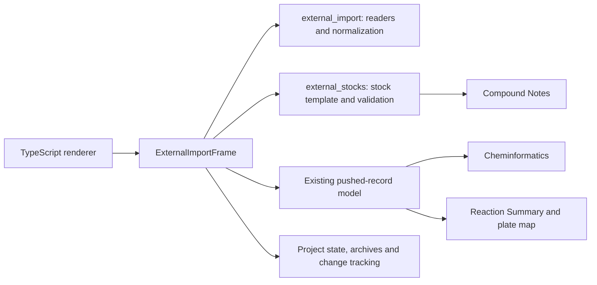

# External Import

External Import is available in Synthesis Plan in this source snapshot and its
matching executable. Launch `Launch_XinPilot.bat` after source setup, or use the
standalone Windows executable. The historical filename is retained for links.

## User workflow

1. Open **Synthesis Plan → External Import → Import transfer file**.
2. Review suggested columns. Select the transfer volume unit and destination
   format explicitly. Supply a destination labware name if it is absent from
   the file. Click **Validate and preview transfers**.
3. Review the source-stock table. Each source is identified by its labware name
   **and** well label. Exact Chemical IDs match Compound Notes; missing and
   ambiguous IDs are shown. Select a source, choose/type its ID, set whether it
   is a structural building block, and click **Apply to selected source**.
4. Alternatively, generate the **source-stock Excel template**, fill chemical
   information and import it. It already contains the source locations from
   the transfer file. Confirm the proposed additions to Compound Notes.
5. Review **Transfer preview**, then **Push All to Cheminformatics**. All
   mapped chemicals contribute to Reaction Summary, including additives.
   Only building blocks participate in structure generation. Re-pushing
   replaces the previous External Import push; other workflows remain.
6. Use the existing Cheminformatics, LCMS and Product Summary workflow.
   Export the project to preserve the imported transfers, mappings, chemical
   records and exact original file. Original files also appear under
   `assets/external-import/` inside the ZIP. Source-stock templates are retained.

Use **Save mappings / Load mappings** to reuse column and source assignments.
Loaded mappings always require another validation/preview. A new file resets
its unit and format; reusing a mapping must be reviewed against that file.
Previously pushed records remain until the next push. The existing
Cheminformatics clear-pushed operation clears them in the usual way.

## Input contract

Supported transfer files:

- CSV, TSV and delimiter-separated `.txt`, UTF-8, with a header row.
- `.xlsx` and `.xlsm` value tables. Choose a worksheet when multiple sheets
  contain data. Macros are not executed; formula-containing sheets are rejected
  to avoid interpreting missing or stale cached values as transfer amounts.
- JSON arrays of transfer objects, or one `transfers`, `worklist` or `rows`
  array. Nested object fields are flattened into dotted column names for mapping.
  Nested arrays and executable vendor protocol languages are unsupported.

Required transfer fields: source labware, source well, destination well and
volume. Destination labware must come from a column or the user-entered name.
Chemical ID is optional in the transfer file. Each row is one transfer; repeated
rows are retained because they can represent repeated additions.

Units are uL, mL or nL. Volumes must be positive finite numbers. Well identifiers
must be explicit labels such as A1; numeric vendor positions are not guessed.
Destination labels are checked against the selected geometry. Source geometry
is not inferred from vendor names; the importer checks source label syntax.
One reaction destination plate is supported per import, with multiple source
labware. Conflicting destination geometries/orientations in existing pushed
records block a new external push.

Limits: 25 MB original file, 100,000 transfers; the preview displays the first
1,000 transfers. These bounds are not a performance guarantee for large files.
This is a generic table importer, not a claim of tested compatibility with
every Hamilton, Chemspeed, Beckman or Agilent native format.

## Source-stock template

Source labware + source well + Chemical ID are required. Optional fields are
SMILES, CAS, Chemical name, concentration and unit, and building-block status.
Concentration units are M, mM or uM. Blank concentration leaves amount in µmol
unknown; it never changes the imported dispense volume. When concentration is
known, `amount (µmol) = volume (µL) × concentration (M)`.

Existing Compound Notes entries are not overwritten. Supplied structures are
compared using canonical isomeric SMILES; conflicting structure, concentration
or CAS information blocks the template import before any additions are made.
Correct existing records in Compound Notes first. New records are added only
after confirmation; valid SMILES also supplies molecular weight via RDKit.
CAS-only entries can be enriched later using the existing Compound Notes lookup.
Building blocks need structures before pushing.

## Architecture

- `xinpilot/application/external_import.py`: bounded readers, column suggestions,
  normalized transfer validation, source identity and pushed-row generation.
- `xinpilot/application/external_stocks.py`: Excel template and staged compound
  additions with structure/concentration checks.
- `external_import_frame.py`: UI adapter using the existing Tk-to-TypeScript
  renderer. No new JavaScript bridge protocol or chemistry engine is introduced.
- `integrated_full_software.py`: editor registration, Compound Notes additions,
  push callback, state restore and new-synthesis-step reset.
- `project_state.py`, `project_archive.py`, `project_history.py` and
  `project_change_tracking.py`: optional backward-compatible external section,
  byte-exact original preservation and change detection.
- `cheminformatics_frame.py`: external source push entry point.
- `reaction_summary_frame.py`: external transfer details and unknown amounts.

The application services have no GUI dependencies. Excel and RDKit dependencies
are imported only in the functions that need them. Original and Modified
PyParse code are unchanged.

## Validation scope

Included automated tests use synthetic transfer and chemical data. Regression coverage includes
invalid volumes/wells, single-plate enforcement, mapping ambiguity, exact file
preservation, stock-template conflicts, repeated-push replacement, mixed-source
records, Suzuki product generation, 48-well geometry and portable round trips.

The native TypeScript acceptance test operates rendered controls from import
through template import, push and export. Only the system file chooser is
stubbed to select test paths. Run `tests/desktop/test_external_import_window.py`
with the configured development environment, or `scripts/run_checks.py --gui`.

An additional development check used a published Chemspeed dispense-volume CSV,
converted from wide columns to transfer rows with reconstructed display wells.
Both 96-experiment projects passed structure-generation and archive/display
checks. This was not direct native-format import or a verified physical deck
mapping. The downloaded paper/data and generated projects are not bundled here.
No vendor execution or instrument-control compatibility is claimed.
